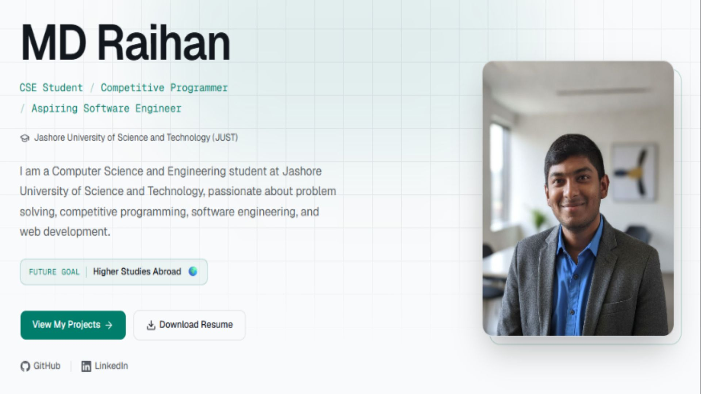

<div align="center">

# MD Raihan — Personal Portfolio

**CSE Student · Competitive Programmer · Aspiring Software Engineer**

A fast, responsive and interactive personal portfolio built with Next.js, React, TypeScript and Tailwind CSS.

[](https://raihan-portfolio-jade.vercel.app)


<br />



</div>

---

## About

This is my personal portfolio website. I am a Computer Science and Engineering student at **Jashore University of Science and Technology (JUST)**. The site brings together my education, skills, projects, competitive programming profiles, achievements and certifications in one place.

I built it while learning frontend development, so the code is kept simple and readable: all personal content lives in a single config file, and every section is its own small component.

## Features

**Interactive**
- Typing animation in the hero section that cycles through my roles
- Animated stat counters that start when they scroll into view
- Certificate preview in a pop-up (native `<dialog>`), with open-in-new-tab and download buttons
- One-click "Copy email" button in the contact section
- Scroll progress bar under the navbar and a back-to-top button
- Navbar that highlights the section you are currently reading
- Smooth reveal-on-scroll animations

**Design and accessibility**
- Light and dark theme, with no flash of the wrong theme on page load
- Fully responsive, from small phones to large screens
- Respects the "reduce motion" setting of the operating system
- Keyboard friendly: skip-to-content link, visible focus rings, Esc closes pop-ups
- Semantic HTML and screen-reader labels

**SEO**
- Open Graph and Twitter meta tags
- Auto-generated social share image (`opengraph-image.tsx`)
- `sitemap.xml` and `robots.txt`
- Vercel Analytics

## Sections

| Section | What it shows |
|---|---|
| Home | Name, roles, university, future goal, resume and social links |
| About | Short introduction and quick stats |
| Education | University, department, program and academic status |
| Skills | Languages, frontend, backend and database, tools, current learning |
| Projects | Featured projects with preview, tech stack, GitHub and live links |
| Competitive Programming | Profiles on Codeforces, CodeChef, AtCoder, LeetCode and more |
| Learning Journey | Step-by-step timeline of how I learned |
| Achievements | Highlights and milestones |
| Certifications | Certificates with an in-page preview |
| Resume | View or download my resume |
| Contact | Email, phone, GitHub, LinkedIn and location |

## Featured Projects

| Project | Description | Links |
|---|---|---|
| **QuizMaster — Online Quiz System** | Quiz platform for Class 9–10 students: chapter-wise practice, timed exams, leaderboard and admin panel | [Live](https://online-quiz-system-roan-zeta.vercel.app/) · [Code](https://github.com/mdraihan2010/online-quiz-system) |
| **StockPilot — Inventory Management System** | Inventory, sales and purchase management with role-based access, dues, returns and reports | [Live](https://inventory-management-system-rouge-nu.vercel.app/) · [Code](https://github.com/mdraihan2010/inventory-management-system) |
| **Personal Portfolio Website** | This website | [Live](https://raihan-portfolio-jade.vercel.app) |

## Tech Stack

| Area | Tools |
|---|---|
| Framework | [Next.js](https://nextjs.org/) (App Router), [React](https://react.dev/) |
| Language | TypeScript |
| Styling | [Tailwind CSS](https://tailwindcss.com/), [shadcn/ui](https://ui.shadcn.com/) |
| Icons | [Lucide](https://lucide.dev/) |
| Hosting | [Vercel](https://vercel.com/) + Vercel Analytics |
| Package manager | pnpm |

## Project Structure

```text
raihan-portfolio/
├── app/
│   ├── layout.tsx             # Fonts, metadata (SEO) and theme setup
│   ├── page.tsx               # Puts all sections together
│   ├── globals.css            # Theme colours and animations
│   ├── opengraph-image.tsx    # Social share image
│   ├── robots.ts              # /robots.txt
│   └── sitemap.ts             # /sitemap.xml
├── components/
│   ├── sections/              # One file per section (hero, about, projects, ...)
│   ├── ui/                    # Reusable UI parts
│   ├── site-header.tsx        # Navbar
│   ├── typing-text.tsx        # Typing animation
│   ├── count-up.tsx           # Animated counters
│   ├── certificate-viewer.tsx # Certificate pop-up
│   └── ...
├── lib/
│   └── site-config.ts         # All personal content lives here
└── public/
    ├── images/                # Profile photo
    ├── projects/              # Project preview images
    ├── certificates/          # Certificate PDFs
    └── resume.pdf
```

## Getting Started

You need [Node.js](https://nodejs.org/) (v20 or newer) and [pnpm](https://pnpm.io/).

```bash
# 1. Clone the repository
git clone https://github.com/mdraihan2010/raihan-portfolio.git
cd raihan-portfolio

# 2. Install dependencies
pnpm install

# 3. Start the development server
pnpm dev
```

Then open [http://localhost:3000](http://localhost:3000).

Other commands:

```bash
pnpm build   # Create a production build
pnpm start   # Run the production build
```

## Updating the Content

Almost everything you see on the site comes from **`lib/site-config.ts`**. You do not need to touch the components to update it.

- **Personal info** — name, role, university, email and social links in `siteConfig`
- **Skills** — edit `skillGroups`
- **Projects** — add an object to `projects`; put the preview image in `public/projects/` and set `image: '/projects/your-image.png'`
- **Certificates** — put the PDF in `public/certificates/` and add it to `certifications`
- **Resume** — replace `public/resume.pdf`

The stat counters in the About section are counted from this file, so they update automatically.

## Deployment

The site is deployed on **Vercel**. Every push to the `main` branch builds and deploys a new version automatically.

## Contact

- **Email:** [mdraihan20104@gmail.com](mailto:mdraihan20104@gmail.com)
- **LinkedIn:** [mdraihan2010](https://www.linkedin.com/in/mdraihan2010/)
- **GitHub:** [@mdraihan2010](https://github.com/mdraihan2010)
- **Codeforces:** [Raihan20](https://codeforces.com/profile/Raihan20)

---

<div align="center">

If you like this portfolio, feel free to give it a ⭐

</div>
